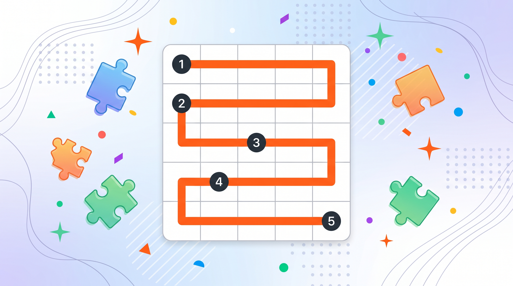

<h1 align="center">
    Concurrent Programming Practical Work [2026]
</h1>

<p align="center">
    <strong>Practical work repository for the Concurrent Programming course</strong>
    <br>
    <strong>- <a href="https://www.unlam.edu.ar/">UNLaM</a> (National University of La Matanza) -</strong>
</p>

<p align="center">
    <a href="#summary">Summary</a> •
    <a href="#installation">Installation</a> •
    <a href="#how-to-contribute">How to contribute</a> •
    <a href="#project-structure">Project structure</a>
    <br>
    <a href="#development-team">Development team</a> •
    <a href="#additional-material">Additional material</a>
</p>

<p align="center">
	
</p>

## Summary

This repository contains our practical work for the Concurrent Programming course at the [National University of La Matanza (UNLaM)](https://www.unlam.edu.ar/). It is a recreation of [LinkedIn's Zip game](https://www.linkedin.com/help/linkedin/answer/a7445030), developed in Java with multithreading and concurrency concepts.

## Installation

1. Clone the repository and install [SDKMAN!](https://sdkman.io/).
2. Open a terminal, navigate to the repository folder, and run `sdk env install`.
3. Run the `scripts/health-check.sh` script to check that all the necessary tools are installed.
4. Run the `scripts/run.sh` script to run the project.
5. That's it! A window should open with the project running.

## How to contribute

1. Clone the repository.
2. Install [Visual Studio Code](https://code.visualstudio.com/), [Docker](https://www.docker.com/), and [Dev Containers](https://marketplace.visualstudio.com/items?itemName=ms-vscode-remote.remote-containers).
3. Open the repository folder in Visual Studio Code.
4. Reopen the project in a Dev Container, pressing `F1` and selecting `Dev Containers: Rebuild and Reopen in Container`.
5. Wait for the container to be built and started.
6. That's it! You are ready to contribute to the project.

> [!NOTE]
> To run the project, you must follow the steps in the [installation section](#installation) (avoid the first step), as the Dev Container can not render the project window.

## Project structure

```text
TP-Integrador/
├── .devcontainer/
│   └── devcontainer.json          # DevContainer definition (Java, EditorConfig, extensions)
├── docs/
│   ├── openspec/
│   │   └── Propuesta.md           # Project specification and concurrency design summary
│   └── statics/
│       └── billboard.png          # Repository banner image
├── scripts/
│   ├── build.sh                   # Compiles src/ with --release 17 -Xlint:all into build/app.jar
│   ├── health-check.sh            # Checks java, javac, and jar availability
│   ├── run.sh                     # Builds and launches Main
├── src/
│   ├── controller/
│   │   ├── ActualizacionVista.java # Immutable UI view-state snapshot
│   │   └── MotorJuego.java        # Single-consumer event loop, game flow, and tomato timer
│   ├── events/
│   │   ├── DestinoCelda.java      # Level-tagged mouse target payload
│   │   ├── EventBus.java          # Bounded BlockingQueue producer-consumer bus
│   │   ├── Evento.java            # Event record and TCP line codec
│   │   └── TipoEvento.java        # Event type enumeration
│   ├── model/
│   │   ├── Celda.java             # Grid coordinate record
│   │   ├── Dificultad.java        # Grid sizes and checkpoint counts
│   │   ├── Direccion.java         # Orthogonal movement directions
│   │   ├── EstadoJuego.java       # Immutable board state snapshot
│   │   ├── GeneradorNivel.java    # Backbite Hamiltonian generator with unique-solution minimization
│   │   ├── Nivel.java             # Immutable puzzle definition
│   │   ├── ReglasJuego.java       # Movement and path validation rules
│   │   ├── ResultadoMovimiento.java # Move evaluation outcomes and user messages
│   │   ├── SolucionadorZip.java   # Backtracking solver with pruning and interruption support
│   │   └── TableroZip.java        # Stateful board progression and undo/rewind logic
│   ├── network/
│   │   └── GestorRed.java         # TCP Host/Client connection manager and multi-peer relay
│   ├── ui/
│   │   ├── AdaptadorMouse.java    # Mouse drag-to-cell input adapter
│   │   ├── CapaVictoria.java      # End-of-match glass-pane overlay
│   │   ├── PanelConfiguracion.java # Unified Multiplayer/Single-Player configuration screen
│   │   ├── PanelJuego.java        # Gameplay screen, HUD, and keyboard bindings
│   │   ├── PanelTablero.java      # Custom 2D grid, path, number, and tomato renderer
│   │   ├── Tema.java              # Swing palette, typography, and component factory
│   │   └── VentanaJuego.java      # Main JFrame coordinator and connection lifecycle guard
│   ├── utils/
│   │   └── Constantes.java        # Network, timer, and round defaults
│   └── Main.java                  # Application entry point
├── .editorconfig                  # Formatting rules across IDEs
├── .gitattributes                 # Line-ending normalization
├── .gitignore                     # Ignored build artifacts
├── .sdkmanrc                      # SDKMAN! Java version
└── README.md                      # This file
```

## Development team

- [Farias Maira](https://github.com/maifarias)
- [Hoz Lucas](https://github.com/hozlucas28)
- [Loiero Federico](https://github.com/FNLoiero)
- [Massa Valentin](https://github.com/ValentinMassa)
- [Niedfeld Kevin](https://github.com/KevinNied)
- [Zapata Santiago](https://github.com/Santiago01011)

## Additional material

